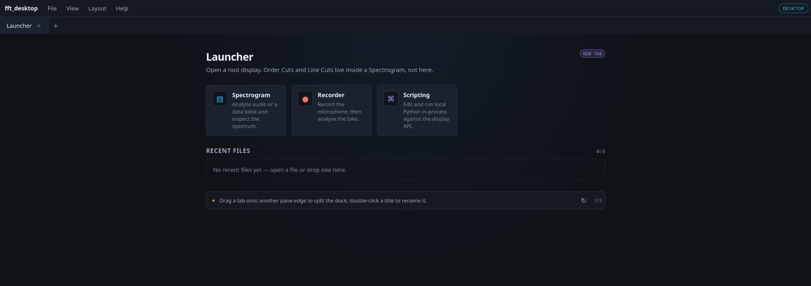
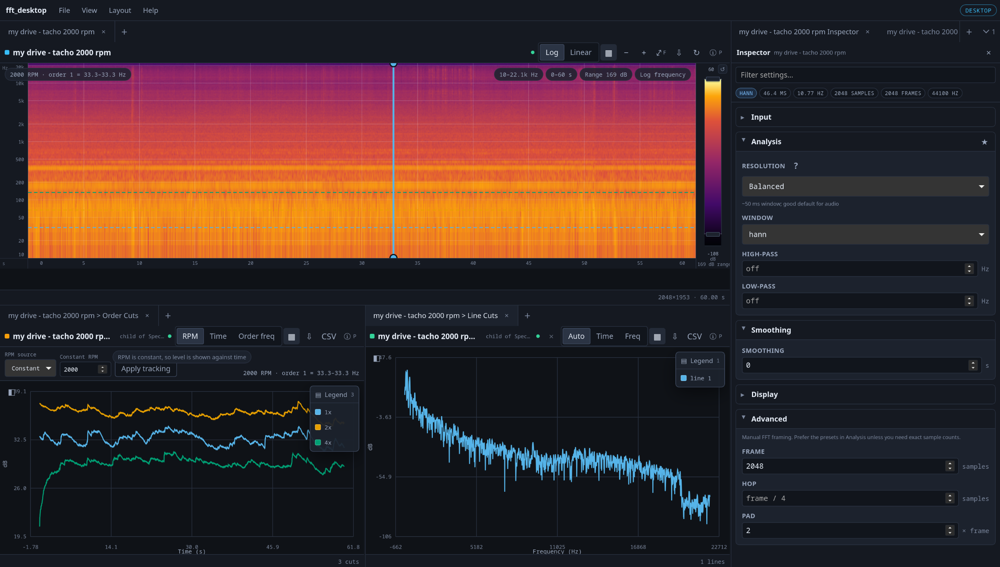

# fft_audio

Spectrograms, order cuts, and line cuts for **audio files and data tables**.

`fft_audio` ships one product binary, `fft_desktop`, with two frontends built from the same React/TypeScript UI:

* a **Tauri 2 desktop app**;
* a **headless WebUI** served by the built-in HTTP adapter, loopback by default.

The Rust side is UI-agnostic: DSP, decoding, tables, cuts, sessions, and themes live in the core crates, while the
desktop and headless adapters only translate transport to the shared app model.

Whether using it in the desktop gui, driving it in headless with direct support for python scripting (more language support to come!), the headless WebUI, or the static wasm build for full operation on the your local browser (currently no scripting support when used in the browser): it supports various audio codecs and containers, along with support for `csv`,`parquet`, `arrow` and many more formats.




## Quick start

### Prerequisites

* Rust/Cargo 1.100+
* Node.js 26+ and npm
* Tauri 2 Linux packages: `webkit2gtk-4.1`, `gtk+-3.0`, `librsvg-2.0`, and `pkg-config`
* For the default desktop build: Python 3.10+, NumPy, and Python development headers

Install frontend dependencies and build the UI once:

```sh
npm --prefix web install
npm --prefix web run build
```

The product build script rebuilds stale `web/dist` automatically for `http`/Tauri builds when `node_modules` already
exists. Set `FFT_SKIP_WEB_BUILD=1` to skip that step.

### Desktop app

```sh
cargo run -p fft_desktop
```

The default feature set is `tauri_python`: the desktop GUI with the embedded Python scripting panel.

GUI without scripting:

```sh
cargo run -p fft_desktop --no-default-features --features tauri
```

`--headless` suppresses the GUI. With no other CLI action it starts no listener and exits successfully:

```sh
cargo run -p fft_desktop -- --headless
```

### Headless WebUI

```sh
cargo run -p fft_desktop --no-default-features --features http -- \
  --serve --port 8765 --bind 127.0.0.1 --dist web/dist
```

Open <http://127.0.0.1:8765>.

`--serve` starts the HTTP/WebSocket server and does not launch the GUI. It binds `127.0.0.1:8765` by default;
`--bind` accepts any local IP or `IP:PORT`, including `0.0.0.0` for every interface. The WebUI has no
authentication, so only bind beyond loopback on a trusted network. See
[Headless HTTP API](docs/http-api.md) for routes and WebSocket events.

### Static browser build

Build a self-contained browser bundle (WebAssembly + Web Worker) that can be served from any static host with no
application server or upload endpoint:

```sh
./build-web-static.sh
# then serve web/dist/, python for example:
python -m http.server 8031 --directory web/dist/

```

This optional build requires the `wasm32-unknown-unknown` target and the `wasm-bindgen` CLI. Settings, session, and
user themes stay in browser storage; files are decoded and analysed locally. Scripting is not included in this build.
See [Static browser build](docs/static-browser.md) for details and limitations.

### CLI Python scripting

```sh
cargo run -p fft_desktop --no-default-features --features python -- \
  --python-script examples/harmonics_chirp_example.py --workers 1
```

Run a script while serving the WebUI:

```sh
cargo run -p fft_desktop --no-default-features --features http,python -- \
  --serve --port 8765 --dist web/dist \
  --python-script examples/three_tones_example.py
```

`--python-wait` waits for Enter, and `--python-delay <SECONDS>` waits a fixed time, after the server starts and before
the first script. Use them when you want to open the browser before scripted displays appear.

`--fresh` resets app config files in the resolved config directory:

```sh
cargo run -p fft_desktop -- --fresh
```

It removes only `settings.toml`, `session.json`, and direct `themes/*.toml` files. It never removes directories or
symlinks and does not require `--config-dir`.

## Basic usage

### Launcher

New tabs start as a **Launcher**. It opens root displays:

* **Spectrogram** — analyze and display an audio file or data table.
* **Scripting** — desktop builds with `tauri_python`; opens the editor-first Python workspace.

Order Cuts and Line Cuts are children of a Spectrogram, not Launcher tiles. Create them from the **Cuts** menu or
the plot context menu. The **+** action on any tab group always opens a new Launcher tab to the right of the active
tab. Recent files and a file-drop overlay are available where the platform supports them. Use **Browse…** or the
browser upload picker in the headless WebUI.

### Spectrogram

The top bar has **File / View / Layout / Cuts / Help** menus; `Ctrl+K` opens the command palette. The display header
has **Log / Linear**, **Fit view**, **Export image**, **Re-analyse**, **Cancel**, and **Toggle inspector**. Export
image and **File → Export image** quick-export the current plot view; the Spectrogram image is the visible data
viewport only, while cut plots include axes and the legend. The plot supports wheel frequency pan, Shift+wheel time
pan, Ctrl/Cmd+wheel zoom,
double-click fit, drag-to-zoom, Shift/middle/touch pan, a live crosshair read-out,
a frequency/time axis, a draggable color range, and a whole-file mini-map.

### Order Cuts and Line Cuts

Both are child displays of a Spectrogram and recompute when a new analysis finishes.

* **Order Cuts** — cuts from `[order_cuts]` defaults or the cut editor; switch the x-axis between RPM, time, and order
  frequency. RPM tracking can be constant, ramped, or loaded from a `time_s,rpm` CSV.
* **Line Cuts** — add lines from the parent Spectrogram's right-click **Add line here**; edit constant-frequency or
  rotated lines and drag endpoints on the cut plot or parent overlay.

Both have top-right **Grid lines**, **Export image**, **Export CSV**, and **Toggle inspector** actions, share a
right-click plot menu, and support a color legend, curve selection, deletion, editing, and stale badges.

Each child opens its own Inspector for display-specific tracking, width, snap, and grid settings. The Spectrogram
Inspector retains the full Input/Analysis/Smoothing/Display/Advanced cards.

### Inspector and Settings

`P` toggles the Inspector for the active display. It includes **Input**, **Analysis**, **Smoothing**, **Display**, and
**Advanced** cards. Analysis offers sample-rate-based resolution presets; **Advanced** has manual frame/hop/pad and
shows table-only options (column, time column, sample rate, remove mean) only for data-table inputs. Display-only
changes apply immediately; DSP changes are staged and use **Revert** or **Apply & re-analyse**. The star action saves
the current analysis/display settings as defaults for new Spectrograms.

`Ctrl+,` opens Settings:

* **General** — restore the last session.
* **Appearance** — theme, UI scale, reduced motion, high contrast.
* **Keyboard** — searchable shortcut list.
* **Files** — config/session/theme paths.
* **Themes** — built-in and user themes, parse errors, duplication.
* **About** — version and stack information.

`Ctrl+K` opens the command palette. `F1` shows the shortcut reference. `Ctrl+T` opens a new Spectrogram, `Ctrl+W`
closes the active tab, and `Ctrl+Tab` cycles tabs.

### Config, sessions, and themes

Desktop paths use the identifier `com.fft-audio.desktop`:

* Linux: `~/.config/com.fft-audio.desktop/`
* macOS: `~/Library/Application Support/com.fft-audio.desktop/`
* Windows: `%APPDATA%\com.fft-audio.desktop\`

CLI/headless runs use `~/.config/fft_audio/` by default or the directory passed to `--config-dir`.

Both contain `settings.toml`, `session.json`, and `themes/`. Built-in themes live in
`crates/fft_core/assets/themes/{dark,light}.toml`; user themes are TOML files with optional `extends` and the required
appearance/color tokens. The theme validator checks tokens, palette size, color parsing, and WCAG contrast.

Sessions store the Dockview layout, display metadata, recent files, and layout presets. `settings.toml` controls FFT
defaults, display defaults, order/line cut defaults, and appearance.

## Data tables

Supported formats: `csv`, `tsv`, `tab`, `txt`, `dat`, `json` (array of row objects), `ndjson`/`jsonl`, plus
`parquet`/`pq` and `arrow`/`ipc`/`feather` when the corresponding table features are enabled.

The core reads a header row, infers numeric columns, pads short rows, and rejects rows with too many fields. Configure
the signal column, time column, sample rate, and **Remove mean** in **Inspector → Advanced**. The same defaults live
under `[analysis.data]` in `settings.toml`.

## Project layout

```
crates/
  fft_core            DSP, decoding, tables, cuts, settings, sessions, themes
  fft_wasm            optional browser/WASM bindings for fft_core
  fft_runtime         runtime contracts, CoreRuntime, scheduler, jobs, mock runtime
  fft_app             FftApp/AppLease/display/event contracts
  fft_app_host        the concrete AppHost and lease minting
  fft_test            shared TestApp/TestHost/TestLease doubles
  fft_script          language-neutral scripting contract and test doubles
  fft_http_adapter    HTTP/WebSocket adapter
  fft_tauri_adapter   Tauri IPC adapter
  fft_python_adapter  embedded CPython/NumPy engine
  fft_desktop         the product binary and composition root
  fft_shipping        shipping matrix CLI
  fft_benchmarks      Criterion DSP/spectrogram benchmarks
web/                  Vite + React + TypeScript UI
examples/             Python examples embedded in the desktop binary
build-web-static.sh   static browser/WASM bundle builder
shipping.toml         default product feature/build matrix
```

Dependency direction is core/data → runtime/contracts → host → adapters → `fft_desktop`. Only `fft_desktop` owns the
app host and mints leases; adapters borrow scoped leases and never create them.

## Deeper docs

* [Architecture and crate boundaries](docs/architecture.md)
* [Development, feature matrix, and shipping](docs/development.md)
* [Full UI and interaction notes](docs/ui.md)
* [Headless HTTP/WebSocket API](docs/http-api.md)
* [Static browser build](docs/static-browser.md)
* [Python scripting and examples](docs/scripting.md)

Example scripts live in [`examples/`](examples/). The typed Python stub is
[`crates/fft_python_adapter/src/fft_audio.pyi`](crates/fft_python_adapter/src/fft_audio.pyi).

## Troubleshooting

* **Wayland crash (`Error 71 ... Wayland display`)** — the Linux binary sets
  `__NV_DISABLE_EXPLICIT_SYNC=1` when unset. Force X11 for a stubborn NVIDIA/Wayland setup with
  `FFT_AUDIO_FORCE_X11=1 cargo run -p fft_desktop`.
* **Stale frontend** — run `npm --prefix web run build`. The build script also rebuilds stale web assets for
  `http`/Tauri builds.
* **Port already in use** — choose another `--port`; `--port 0` uses an ephemeral port.
* **WebUI unreachable from another machine** — it binds `127.0.0.1` by default; pass
  `--bind 0.0.0.0` (or the interface IP) to listen more widely. There is no authentication, so do this only on a
  trusted network.

More build, test, and environment details are in [Development](docs/development.md).
